# Limn

A high quality, performant, realtime, concurrency-first, physically based renderer written in zig with Vulkan 1.3

Part of the [Qaya SDK](https://github.com/QayaSoftware/sdk), where it is developed under
`libs/limn`. [Tofaa2/limn](https://github.com/Tofaa2/limn) is a read-only mirror of it: open
issues and pull requests in the SDK.

Latest docs are published to https://qayasoftware.github.io/sdk/limn/

# Path tracing

Path tracing is WIP and contains noise, unfortunately RTX is an oversold concept for marketing that requires vendor locked software and tooling to make it look actually good. Its recommended to keep regular ray tracing enabled and path tracing disabled.

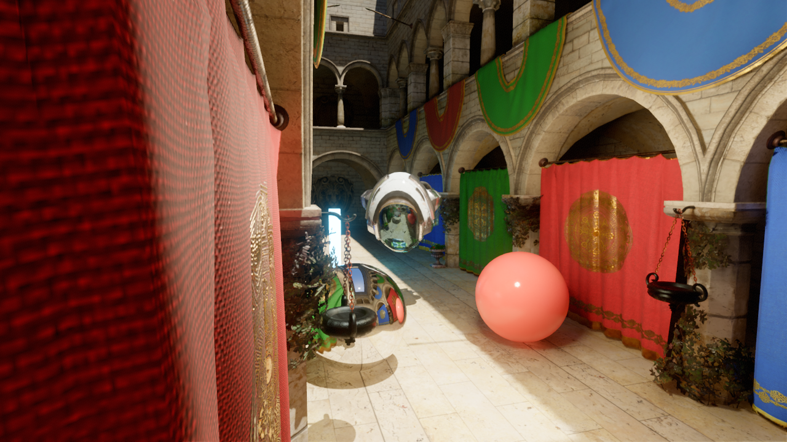

|     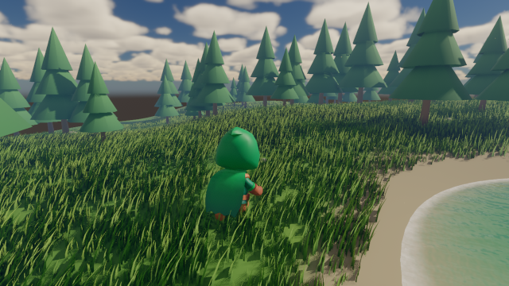     |         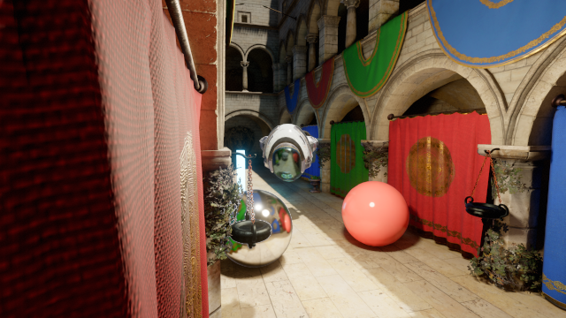         |          |
| :------------------------------------------: | :--------------------------------------------: | :----------------------------------------: |
|                  **meadow**                  |                    **rtx**                     |                 **world**                  |
|  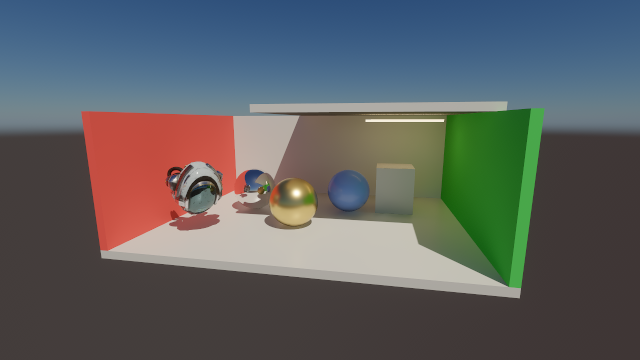  |      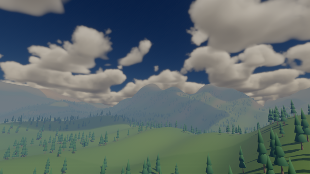      | 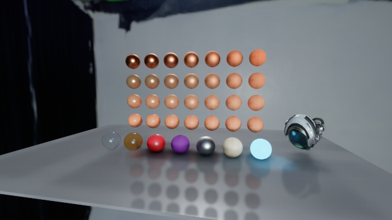 |
|                **pathtrace**                 |                   **clouds**                   |               **materials**                |
|     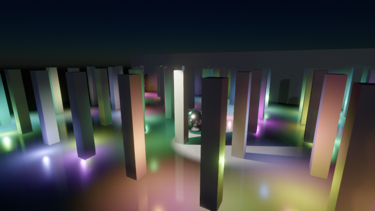     | 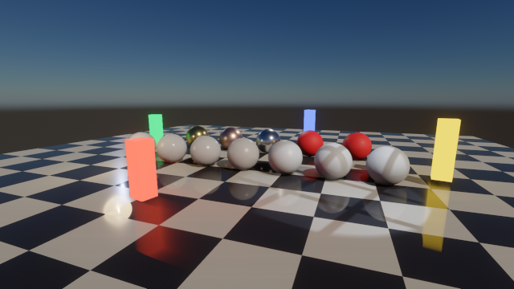 |     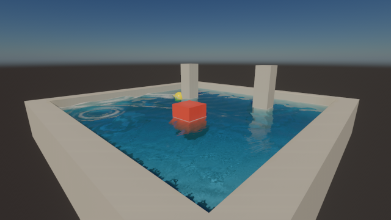     |
|                  **lights**                  |                **reflections**                 |                 **water**                  |
|     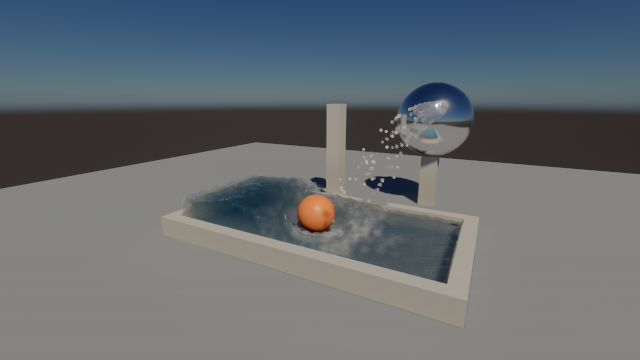     |       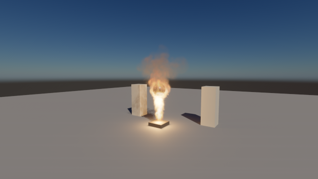       | 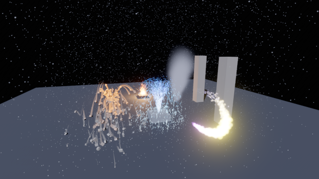 |
|                  **liquid**                  |                   **fluid**                    |               **particles**                |
|       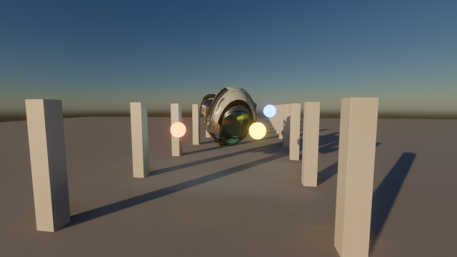       |      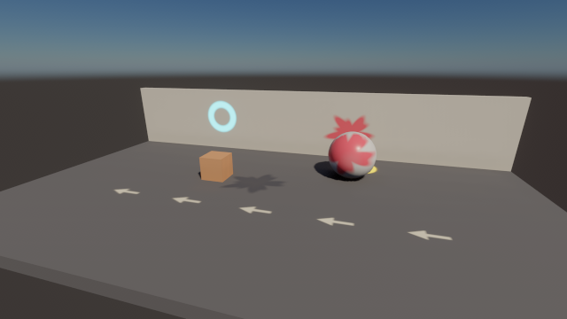      | 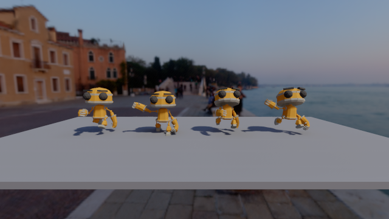 |
|                   **post**                   |                   **decals**                   |               **animation**                |
| 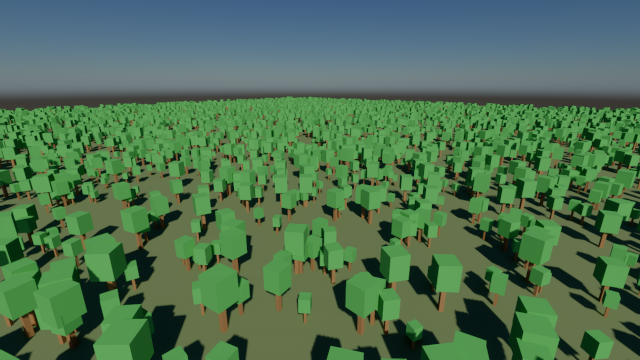 |       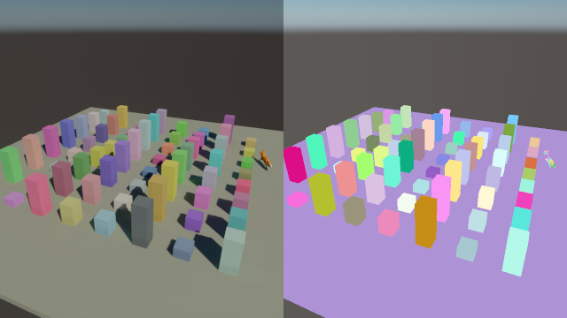       |    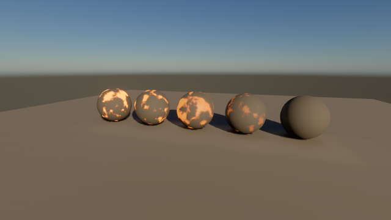    |
|                **instancing**                |                   **views**                    |                 **shader**                 |
|       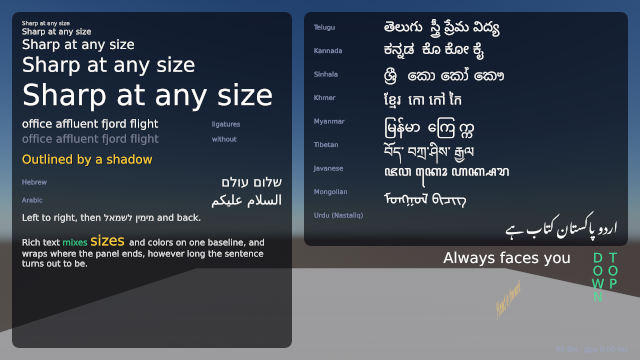       |      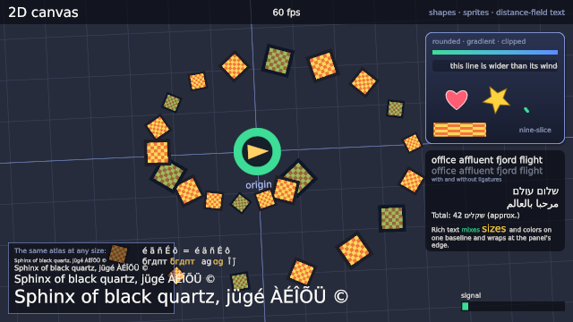      |  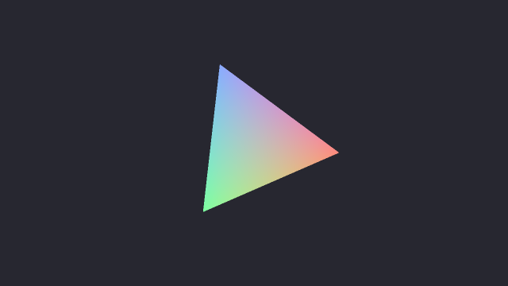  |
|                   **text**                   |                   **canvas**                   |                **triangle**                |
|  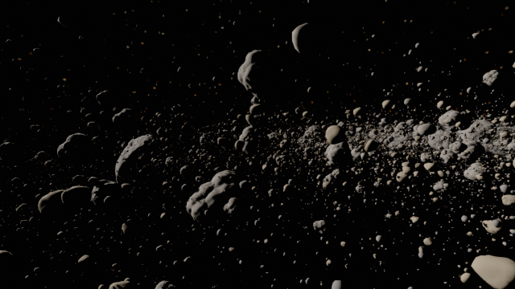  |      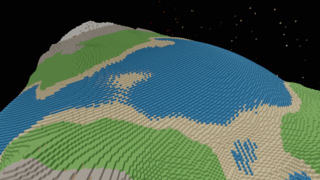      |    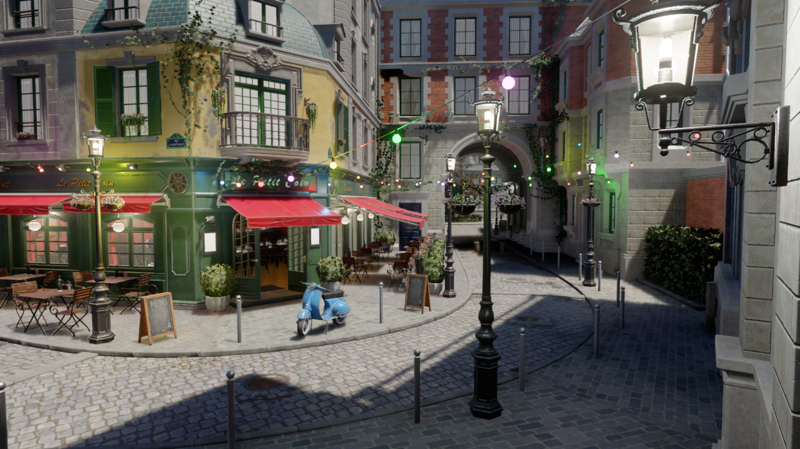    |
|                **asteroids**                 |                   **voxels**                   |                 **bistro**                 |

Every picture is an example in [limn-examples](https://github.com/QayaSoftware/limn-examples):
run it there with `zig build <name>`.

```zig
const gfx = @import("limn");

const renderer = try gfx.Renderer.init(gpa, io, .{ .surface = surface });
defer renderer.deinit();

const scene = try renderer.scenes.create();
const model = try renderer.models.load("helmet.glb");
_ = try renderer.entities.create(scene, .{ .model = model });
renderer.scenes.setSun(scene, .{ .direction = .{ -0.4, -1.0, -0.3 }, .intensity = 5 });

while (running) {
    _ = try renderer.render(.{
        .views = &.{.{ .scene = scene, .camera = gfx.Camera.lookAt(eye, target) }},
        .delta_time = dt,
    });
}
```

## Where to start

| Need | Start from | Example |
|---|---|---|
| 2D only (UI, tools, games) | a `View` with draw lists and no scene | `canvas`, `text` |
| 2D over 3D | draw lists on a scene view | `views`, `post` |
| Simple 3D at the least cost | `Settings.lightweight` | `lightweight` |
| Photoreal 3D | `Settings{}` or `Settings.preset` | `bistro`, `meadow`, `rtx`, `pathtrace` |
| Your own GPU work in a frame | `ViewDesc.passes`, `materials.createShader` | `passes`, `shader` |
| No renderer, just the device layer | `rhi.Device` | `triangle` |

`zig build costs` prints what frames record as each kind of scene grows.

## Build

Requires Zig 0.16 and a Vulkan 1.3 driver. Everything else is fetched by
the build: Slang, glslang and the Android NDK, so `-Dtarget` cross-compiles
from any host (`-Dsystem_tools` uses `slangc` and `glslangValidator` from
PATH instead).

```sh
zig build            # the library
zig build test       # unit tests
zig build checks     # picking, reloading, streaming and out of memory, without a window
zig build verify     # formatting, tests and checks
zig build docs       # API reference in zig-out/docs
zig build cross      # every desktop target and Android, into zig-out/cross
```

## Using it

```sh
zig fetch --save git+https://github.com/Tofaa2/limn
```

```zig
const limn = b.dependency("limn", .{ .target = target, .optimize = optimize });
exe.root_module.addImport("limn", limn.module("limn"));
```

limn's `build.zig` also gives an application's build what limn's own uses:
`addShaders` compiles its Slang shaders, which can include limn's, into SPIR-V
for `@embedFile`, and `applyAndroidLibc` builds it for Android with the
fetched NDK. [limn-examples](https://github.com/QayaSoftware/limn-examples)
uses both, and packs Android builds into APKs.

## Documentation

`zig build docs` writes the API reference from the doc comments in `src`.
After that you can use python to serve you the documentation as a webserver with `python3 -m http.server 8000 -d zig-out/docs`

## Platforms

Developed and tested on Linux with an NVIDIA GPU and with Mesa's software
driver. It cross-compiles for Windows and has been used on Windows and AMD hardware with modern drivers but not as deeply tested as Linux and NVIDIA.

## LLM Notice

AI was used for documentation, README prettification, examples, and specific core content. All code PR'ed to this, repo if LLM developed, requires complete verification by the developer. Slop PR's will not be accepted all LLM code must be reviewed.

## License

Apache-2.0; see [`LICENSE`](LICENSE). Bundled work keeps its own terms:

- meshoptimizer (MIT): `src/third_party/meshoptimizer`
- Basis Universal transcoder (Apache-2.0): `src/third_party/basisu`
- FidelityFX Denoiser, reflection part (MIT): `src/third_party/ffx_denoiser`
- FidelityFX Super Resolution 1 (MIT): `src/third_party/ffx_fsr1`
- FidelityFX SDK 1.1.4, for Super Resolution 2 and 3 (MIT): `src/third_party/ffx_sdk`
- Linearly transformed cosine tables (BSD-style, Heitz et al. 2016): `src/third_party/ltc`
- DejaVu Sans, the built-in font: `src/render/fonts/LICENSE`
- The test model and fonts: `testdata/README.md`; the examples' assets are listed in limn-examples

Not bundled, but built in whenever `dlss_sdk/` or `nrd_sdk/` is present (`zig build dlss-sdk`, `zig build nrd-sdk`): NVIDIA DLSS and NRD, under the NVIDIA RTX SDKs license. Build with `-Ddlss=false -Dnrd=false` to leave them out.
